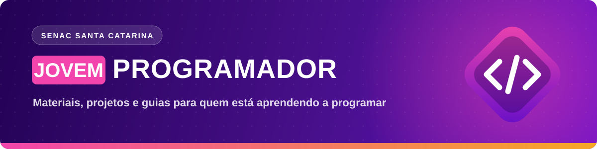

  

 

  
  
  

---

### 👋 Bem-vindo ao GitHub do Senac Santa Catarina

Esta organização reúne materiais didáticos, projetos integradores, desafios de hackathons e guias práticos desenvolvidos por docentes e estudantes das unidades do **Senac SC** e do programa **Jovem Programador**.

### 🚀 Programa Jovem Programador
O [**Jovem Programador**](https://www.jovemprogramador.com.br/) é uma iniciativa de capacitação tecnológica que forma novos talentos em desenvolvimento de software em Santa Catarina, conectando estudantes diretamente às demandas reais do mercado de TI por meio de prática intensiva, mentorias e desafios colaborativos.

---

### 📚 Repositórios em Destaque

| Repositório | Descrição | Público-Alvo |
| :--- | :--- | :--- |
| **[`beneficios-estudante-ia`](https://github.com/senacsc/beneficios-estudante-ia)** | Passo a passo completo para resgatar o **GitHub Student Developer Pack**, **Google AI Plus (Gemini)** e configurar o **Google Antigravity** com o e-mail `@alunos.sc.senac.br`. | Estudantes Senac SC & Jovem Programador |

---

### 🛠️ Trilhas & Tecnologias Trabalhadas

  
  
  
  
  
  
  
  
  

---

  Mantido pela comunidade docente e estudantil do <strong>Senac Santa Catarina</strong>.

